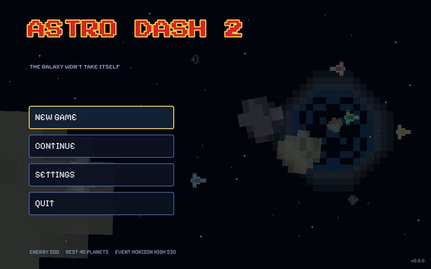
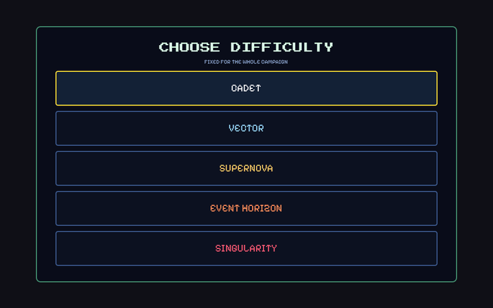
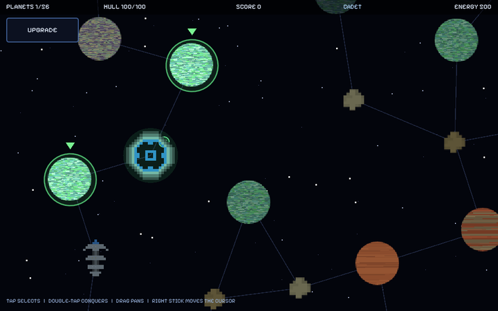
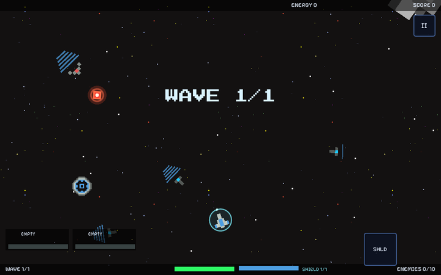
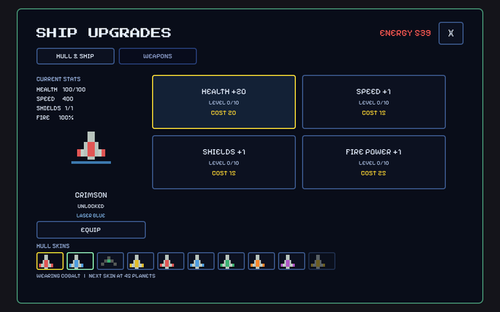
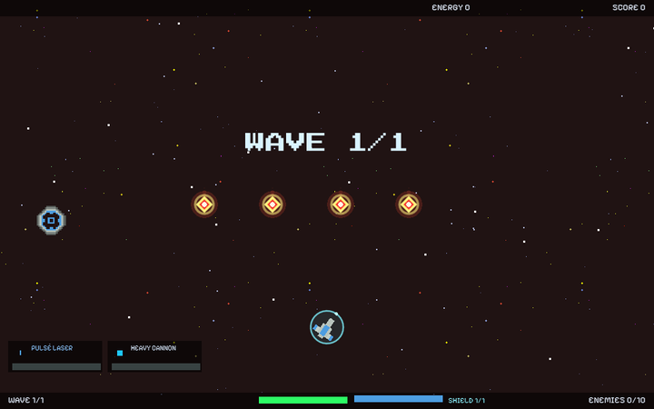
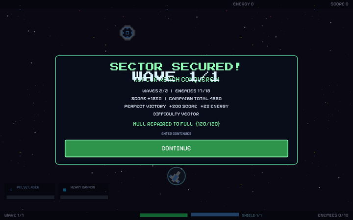

# Astro Dash 2

A landscape twin-stick space shooter built with **Godot 4.7** (GL Compatibility)
for desktop, the web and Android. Fly free in a 960x600 arena, shoot fighters and
asteroids, chain kills for combo score, and take a galaxy one world at a time.

This build is **0.9.0**, the release candidate (the version is also shown in
the corner of the main menu). NEW GAME opens a five-mode difficulty picker, the
hull heals between planets by mode, a defeat follows the mode's own rule (keep
the planets, start a new galaxy, or wipe everything), shielding and two weapon
hardpoints are in, and the music is a cross-faded playlist with a boss theme.
The seeded galaxy campaign and the arena are unchanged in feel.

See [CHANGELOG.md](CHANGELOG.md) for a one-line summary of every build stage.

## Screenshots

Captured at 960x600 with `tests/screenshot_runner.tscn`, downscaled to 720x450
by `tests/doc_shots.gd` and kept in `docs/screenshots/` (the full-size frames
stay in the git-ignored `test_output/`).

| | |
| --- | --- |
|  |  |
| **Main menu** — animated backdrop, footer, version | **Difficulty picker** — five modes, names only |
|  |  |
| **Galaxy map** — seeded bodies, frontier arrows | **Battle** — ship, rock field, wave banner |
|  |  |
| **Ship upgrades** — Hull & Ship tab, ten skins | **Enemy fire** — hot diamonds on the red band |



## What is in this build

### Main menu

- **A drawn title** (`ASTRO DASH 2`, red with a yellow outline) over an animated
  backdrop: ships with thrusters and asteroids drifting across, a large rock on
  the left, a parallax starfield and a slowly turning warpgate.
- **NEW GAME / CONTINUE / SETTINGS / CREDITS / QUIT**, left-aligned, with hover
  and focus highlight from the shared theme. CONTINUE is disabled when no
  campaign is saved. NEW GAME asks first when a run is in progress. CREDITS
  opens a rolled list of every asset, its author and its license; any key or
  click pauses the roll, `Esc` / `B` closes it.
- The footer shows banked energy, the best planets-conquered run and the high
  score.

### Galaxy map (the campaign hub)

- **A stable galaxy per campaign.** ~50-60 bodies are scattered with a seeded
  Poisson-disk layout over a 2300x1500 map, then linked to their nearest
  neighbours (plus bridges so no island is unreachable). The seed is stored in
  the save, so relaunching brings back the same worlds, names, links and
  conquests. The map is panned, never zoomed.
- **Home and gate.** The home system sits nearest the left of the map and starts
  conquered; it is drawn as the animated `warpgate_1..3` loop. The gate is the
  body farthest from home by graph distance, drawn with the same art and tinted
  pink. It stays sealed until three of the five citadels have fallen.
- **Body types**, all with their own sprite and a `modulate` tint (the art is
  never recoloured): minor planets (`asteroid_grey`, `pixel_asteroid`,
  `asteroid_tiny`), rocky/lava (`planet5`/`planet6`), ocean/earth
  (`planet4`/`planet3`), gas giants (`planet1`/`planet2`) and citadels
  (`pixel_station_blue/green/red/yellow`, every colour used). All six planets and
  all four stations appear in every galaxy.
- **Procedural names and traits** from `game/campaign/galaxy.gd`, unique per galaxy. Each body
  has a trait — `MINOR PLANET`, `RESOURCE RICH`, `FERTILE`, `FORTRESS`,
  `CITADEL`, `HOME SYSTEM`, `THE FINAL GATE` — which changes payout and battle.
- **Interaction.** Hover or tap for a tooltip (name, trait, band, waves, enemies,
  boss, status). Attackable neighbours glow green with a bouncing arrow;
  conquered bodies are green-tinted with a check badge; locked ones are dim.
  Selecting one opens *CONQUER &lt;NAME&gt;?* with 48px green **BATTLE** and red
  **CANCEL**. Arrows / d-pad cycle the frontier, `Enter` / `A` attacks.
- **Top bar:** planets conquered, campaign score, spendable energy. **UPGRADE**
  (top left) opens the ship screen; Back returns to the menu.

### Ship upgrades and skins

- **A 2x2 grid of cards** — HEALTH +20, SPEED +1, SHIELDS +1, FIRE POWER +1 —
  each showing its level 0/10, its price and its precise effect on hover
  (`Upgrades.tooltip`). A card is disabled when it is unaffordable or maxed.
- **Current stats** on the left: HEALTH, SPEED, SHIELDS (current/capacity), FIRE.
  During a campaign HEALTH shows the carried hull; the shield always starts a
  battle full, so it reads capacity/capacity.
- **Energy** in red at the top; **X** closes (48px). Arrow keys / d-pad move
  between cards, `Enter` / `A` buys, `Esc` / `B` / Android Back closes.
- **Fire power is now shared by both hardpoints**: every level adds +12% damage
  and -3% cooldown (cooldown floors at -45%) to whatever is equipped. Only the
  PULSE LASER still changes its art with the track — blue at level 0, green from
  level 3, yellow from level 6 — because its art is the laser itself.
- **A WEAPONS tab** beside HULL & SHIP: one card per weapon showing DAMAGE,
  RATE, projectile SPEED and DPS, plus its state (OWNED, PRIMARY, SECONDARY,
  COST n ENERGY, UNLOCKS AT n PLANETS). Selecting a card previews its projectile
  large and in its own colour on the left; **BUY** spends energy, **EQUIP
  PRIMARY** / **EQUIP SECONDARY** fill the two hardpoints. A weapon may only sit
  in one slot, and the secondary starts empty.
- **Ten hull skins** in the picker: `pixel_ship_red/blue/yellow` plus the green
  interceptor, then the six stroked hulls. They unlock at 0, 5, 10, 15, 20, 25,
  30, 35, 40 and 45 planets conquered (best run counts, so a skin can unlock
  mid-run, or across campaigns through lifetime conquests). The picker is saved
  as `skin` and the ship wears it in battle.

### Battles from a body

- **Difficulty from distance.** Graph hops from home pick a band: 6 to 14 enemies
  per wave, 1 to 3 waves, a heavier mix, more rocks and a different backdrop
  (`background-black`, `-blue`, `-purple`, `-red`). The trait bends it again.
- **Carried hull.** HP carries from one campaign battle to the next and is saved
  with every conquest; the shield refills to its full capacity at the start of
  every battle. Upgrade levels apply on top.
- **Citadel boss.** A citadel's last wave is followed by its station: 190 HP plus
  4 per hop, scaled by the mode's own narrow `boss_hp` multiplier (0.95 CADET to
  1.22 SINGULARITY, so the hardest station is about 1.6x a CADET one). It hovers and
  fires a fan of five red dots, but **telegraphs every fan** with a charge ring
  and an aim line for 0.5 s first, and its opening phase (above 66% HP) hits 25%
  softer and 25% slower. Its name and a red health bar sit under the top readout.
  Beating it pays a large energy bonus and a shield drop.
- **Victory card:** planet name, waves completed, enemies destroyed, score
  earned, campaign total, and a **PERFECT VICTORY** line (+500 score, +25 energy)
  when the hull never dropped below the HP it entered with. **CONTINUE** returns
  to the map.
- **Game-over card:** **NEW HIGH SCORE!** when the run beat the record, final
  score, high score, planets conquered and the deepest band reached. **TRY
  AGAIN** starts a fresh campaign (energy and upgrades kept), **QUIT** returns to
  the menu.
- **Readable enemy fire.** Enemy shots are drawn hot diamonds with a white
  core, a pulsing halo and a short fading trail — never a reused player colour.
  The hitbox is deliberately smaller than the art. **HIGH-CONTRAST BULLETS**
  (Settings, on by default) thickens the outline and brightens the halo; on the
  red band the outline switches to yellow-white.
- **Shields: capacity and charges.** The shield holds `capacity` charges and
  **every battle starts with it full**. The base depends on the mode: 1 charge
  at SHIELDS level 0 on CADET and VECTOR, 0 from SUPERNOVA up, where the first
  shield has to come from a drop (or from three SHIELDS levels). +1 capacity per
  three levels, up to 3. The ship wears a bubble with one pip per charge that
  flashes when a charge is spent, and the HUD reads `SHIELD 2/3` next to the HP
  bar (`NO SHIELD` at zero). About 5% of kills and always a citadel drop a blue
  bubble pickup that refills one charge — even at capacity 0, where it grants a
  real shield; a drop collected while the shield is already full is never wasted
  — it pays 5 energy with a floating readout. The SHIELDS track also recharges
  one charge after a quiet stretch (25 s at level 1 down to 8 s at max, reset by
  any hit).
- **Two hardpoints.** The primary fires on `shoot`, the secondary on `shoot_alt`
  (right mouse / `Shift` / left shoulder or trigger / a second touch button),
  with independent cooldowns and left/right muzzle positions.
- **Everything from 7A stays:** free-flight ship with thruster, HP and shields,
  three fighter types, splitting asteroids, waves, combo, energy orbs, particles,
  shockwaves, camera shake, parallax starfield, touch stick and aim zone.

### Pause, focus and Back

`GameState` owns the tree pause. Losing window focus during a battle pauses it.
Android Back pauses a battle, resumes a paused one, closes the confirm card, the
upgrade screen and the settings card, returns the map to the menu, and quits from
the bare menu. The victory card's Back continues; the game-over card's Back goes
to the menu.

### Settings

**MASTER**, **MUSIC** and **SFX** sliders (each writing its own audio bus, all
persisted), mute (a Master-bus mute), reduce motion, touch auto-fire,
**HIGH-CONTRAST BULLETS** (thicker outline, brighter halo; saved in
`user://save.cfg`) and **REMAP CONTROLS**, which opens the binding card. The note
under the sliders always shows the keys that are bound right now.

**REDUCE MOTION** turns off every screen-shaking and popping effect: camera
shake, the ship's hit flash peak and its scale pop, the fighters' hit flash
peak, shockwave rings, the elite rim glow's pulse (the rim stays, static) and
the wave banner's scale pop (the banner still fades out on its timer). Nothing
it covers changes how the game plays.

Music is a playlist of every `.ogg` / `.mp3` / `.wav` in
`assets/audio/music/`. Settings shows **NOW PLAYING**, **PREV**, **NEXT** and a
**SHUFFLE / IN ORDER** toggle. Shuffle uses a bag, so a full pass plays every
track once and the track that just ended never starts the next pass; tracks
cross-fade over 1.5 s. Releasing the SFX slider plays a short sample at the new
level, and the saved volumes are applied before the first sound. Sound effects
come from the two packs in `assets/audio/sfx/` through `AudioManager.SOUND_MAP`;
events with no file are reported in a single startup warning.

## What is not in this build yet

- **The CC BY-SA track stays.** *Prepare for War* by Trevor Lentz is included
  unmodified as a separate audio file and keeps its own CC-BY-SA 3.0 license;
  the rest of the game is not derivative of it. See Credits.
- **No how-to-play card in game.** The rules are in this README (the `C` card
  lists the live bindings, not the rules).
- **Headless only for tests.** Audio output, touch and the Android build were
  never verified on real hardware; see the limits listed there.

## How to play

1. **NEW GAME** on the menu, then pick a difficulty. The choice is fixed for the
   whole campaign; the map's top bar shows the mode, your hull and the planets
   taken.
2. **Pick a target on the map.** Bodies touching your conquered network glow
   green. Single click (or a gamepad cursor + `A`) selects and shows the tooltip;
   double-click, or `Enter` on a selected body, opens the CONQUER card.
3. **Fly and shoot.** One stick/keyboard moves, the nose follows the mouse in
   FREE AIM (`J` / `L` swing it round with the keyboard), or the ship turns
   under `A`/`D` in CLASSIC. `Space` fires the primary, the secondary fires on
   `shoot_alt`; `Z` raises the shield in MANUAL mode.
4. **Clear every wave.** Fighters, elites, drones and asteroids; big rocks split
   into debris. A citadel sends its station in after the last wave — kill it for
   a large energy bonus and a shield drop.
5. **Spend energy on the ship.** UPGRADE on the map buys hull, speed, shields and
   fire power, and unlocks the weapon rack and hull skins.
6. **Heal and push deeper.** A conquest heals by the mode's rule and raises the
   planet count, which unlocks weapons and skins. Fall, and the mode decides what
   survives (keep the galaxy, start a new one, or wipe the run).

## Controls

Every action except the menu key can be rebound in **Settings > REMAP CONTROLS**:
one keyboard/mouse column, one gamepad column, a per-action reset and RESET TO
DEFAULTS. A key already in use is taken from the other action (the card says
which). Bindings are stored under `[controls]` in `user://save.cfg` and applied
at startup; Esc and Back stay fixed so a remap can never lock the player out.

### Menu

| Action | Input |
| --- | --- |
| Move focus | `Up` / `Down`, left stick / d-pad |
| Choose | `Enter` / `Space` / `A` |
| Close settings or confirm | `Esc` / `B` / Android Back |

### Galaxy map

| Action | Input |
| --- | --- |
| Pan | Drag with the mouse or a finger, `W` `A` `S` `D`, or the left stick |
| Inspect | Hover a body (mouse), or tap it (touch) |
| Attack | Click / tap a glowing body, or select it and press `Enter` / `A` |
| Cycle the frontier | `Left` / `Right` / `Up` / `Down` or the d-pad |
| Upgrades | Click / tap **UPGRADE**, or focus it with the d-pad |
| Close a card | `CANCEL`, `Esc` / `B`, or Android Back |
| Back to the menu | `Esc` / `B` / Android Back on the bare map |
| Zoom | Mouse wheel (around the cursor), pinch, or `+` / `-` |
| Controls card | `C` or gamepad `Back` anywhere |
| Debug battle (debug builds) | `F9` starts the one-wave harness instead |

### Battle

**Keyboard**

| Action | Input |
| --- | --- |
| Move | `W` `A` `S` `D` or the arrow keys |
| Aim | Mouse (the nose follows the pointer once it moves), or `J` / `L` to swing the nose round |
| Fire primary | `Space` or hold left click |
| Fire secondary | `Shift`, hold right click, or the touch **FIRE II** button |
| Raise the manual shield | `Z` (MANUAL shield mode), or the touch **SHIELD** button |
| Pause | `P` or `Esc` |
| Controls card | `C` (pauses while open) |
| Thruster overlay (debug builds) | `F3` draws every hull circle and exhaust anchor |
| End card | `Enter` continues / retries, `Esc` / `B` Back |
| Debug (debug builds) | `R` restarts the harness, `F9` starts it |

**CLASSIC scheme** (Settings > CONTROL SCHEME): `Left` / `Right` or `A` / `D`
turn, `Up` / `W` thrusts, `Down` / `S` brakes (it never reverses), and the nose
is the aim. Both schemes' bindings persist.

**Gamepad** (twin-stick): left stick moves, right stick aims, right trigger or
`A` / Cross fires the primary, left shoulder or left trigger fires the
secondary, `X` / Square raises the manual shield, `Start` pauses, `Back` opens
the controls card, d-pad and `A` navigate cards.

**Touch:** virtual stick on the left half, aim-and-fire on the right half, a
second 48px+ **FIRE II** button for the secondary, 48px pause button. On the map,
drag pans and a tap selects.

Everything reaches the game through InputMap actions (`move_up`, `move_down`,
`move_left`, `move_right`, `aim`, `aim_left/right/up/down`, `shoot`, `shoot_alt`,
`shield`, `controls`, `pause`, plus Godot's built-in `ui_*` actions for every
screen), so no screen asks where an input came from. In FREE AIM the analogue
`aim_*` axes and the keyboard `J` / `L` keys drive the same actions; the aim
source is picked in this order: touch zone, stick, aim keys, mouse.

## How a campaign runs

1. NEW GAME (or CONTINUE) loads the galaxy from `SaveData.campaign_seed`. Home is
   conquered without being stored, so its neighbours are attackable at once.
2. Picking an attackable body builds a `Battle` from its band and trait, hands
   the id to `Campaign` and changes scene. The carried hull is applied after the
   upgrade stats.
3. Waves warp in, combo and energy accrue, and a citadel adds its station after
   the last wave.
4. Victory banks the conquest, run score, carried hull and energy, then
   **CONTINUE** returns to the map so glows and links update.
5. A victory heals the hull by the mode's fraction of MAX HP (clamped), shown on
   the victory card as `HULL +25%  (96/120)` or `HULL REPAIRED TO FULL`.
6. Defeat ends the battle on the game-over card, which shows the mode and its
   rule. CADET/VECTOR keep the galaxy and planets and restore the hull
   (100% / 50%); SUPERNOVA/EVENT HORIZON draw a new galaxy while keeping energy,
   upgrades and weapons; SINGULARITY also wipes the campaign's meta progression.
   The button follows that rule: RETURN TO MAP, NEW GALAXY or START OVER.

## Project structure

```
project.godot, export_presets.cfg, icon.svg, icon-192.png, README.md
                    the root holds nothing but these (and .gitignore)
autoload/           the four global services: GameState, SaveData, AudioManager,
                    UIOverlay
game/battle/        arena root (battle_game), the Battle resource, hazard field,
                    wave director
game/campaign/      campaign run state, seeded galaxy
autoload/           (see above)
entities/           player/, enemies/, projectiles/, pickups/, fx/, hazards/,
                    map/ - the things inside the arena
config/             data and tables only: tuning, difficulty, upgrades, weapons,
                    skins, controls, ui_theme
ui/                 menu/, map/, hud/, panels/ (upgrade, settings, controls,
                    difficulty picker, end/pause/confirm cards)
assets/             sprites/ (the pack structure is kept), audio/sfx/,
                    audio/music/, fonts/, backgrounds/
resources/          default_bus_layout.tres and other shared .tres
resources/          (further shared resources, if any)
tests/              headless suite, battle bot, screenshot runner, path checks
docs/               ARCHITECTURE.md, reorg_plan.md, orphans.md
reference/          reference videos and screenshots, with a .gdignore so Godot
                    never imports them
```

Dependency rules and the menu -> difficulty -> map -> battle -> result flow are
in [docs/ARCHITECTURE.md](docs/ARCHITECTURE.md).

## Collision layers

| # | Value | Layer | Used by | Mask | Reacts to |
| --- | --- | --- | --- | --- | --- |
| 1 | 1 | player | `Ship/Hurtbox` | 28 | enemies (4), rocks (8), enemy bullets (16) |
| 2 | 2 | player bullets | `Bullet/BulletArea` | 12 | enemies (4), rocks (8) |
| 3 | 4 | enemies | every `EnemyBase`, `BossStation` | 0 | nothing (only detected) |
| 4 | 8 | hazards | `Asteroid` | 0 | nothing (only detected) |
| 5 | 16 | enemy bullets | `EnemyBullet` | 0 | nothing (only detected) |

Detection is one-way everywhere: a fighter, station or rock never needs a
reference to the ship, and the ship never needs one to them.

## Running the project

1. Install **Godot 4.7** (standard build; the project uses the GL Compatibility
   renderer so it runs on older GPUs, the web and mobile).
2. Open `project.godot` and press `F5`, or from a terminal:
   ```bash
   godot --path .
   ```
3. Export templates are only needed for exporting (*Editor > Manage Export
   Templates*).

## Tests

Two headless entry points, no editor needed:

```bash
# Logic suite: 128 checks - 123 over difficulty healing and defeat rules,
# shields, upgrades, weapons, the galaxy, audio buses/playlist and key
# rebinding, plus 5 that assert every res:// path in code and scenes exists
# (tests/check_paths.gd). Prints PASS/FAIL per check and a SUMMARY line;
# exits 1 when anything failed.
godot --headless --path . res://tests/run_tests.tscn

# Battle bot: three 60 s campaign fights (CADET pulse+cannon, SUPERNOVA
# missile+rail, SINGULARITY scatter+pulse) that fly, aim, fire both hardpoints,
# wrap, open and close the pause card, then reach the victory and game-over
# cards. It prints the live node count and frame rate every 10 s.
godot --headless --path . res://tests/battle_bot.tscn
# Soak: one continuous battle for N game minutes at 8x speed, restarted on
# every win and loss, printing nodes, orphans, objects and memory once a game
# minute and a growth verdict (over 15% counts as a leak).
godot --headless --path . res://tests/battle_bot.tscn -- soak cadet 20
```

`tests/run_all.ps1` runs the suite through PowerShell and prints the PASS/FAIL
count. The suite copies `user://save.cfg` aside before its first write and puts
it back afterwards, so a real playthrough is not damaged. `tests/README.md`
explains why the suite is a scene rather than a `--script`: `--script` mode has
no autoload globals, so any script naming `SaveData` fails to compile there.

## Balancing

Every number worth tweaking lives in **`config/config/tuning.gd`**, plus UI sizes in
`config/ui_theme.gd` and skin unlock thresholds in `config/skins.gd`. Nothing in the logic
depends on the exact values.

| What | Constant(s) |
| --- | --- |
| Canvas and arena | `VIEW_SIZE` (960x600), `HUD_BAR_HEIGHT` (24), `ARENA_TOP/BOTTOM/LEFT/RIGHT`, `ARENA_MARGIN` |
| Ship flight | `SHIP_MAX_HP`, `SHIP_ACCELERATION`, `SHIP_MAX_SPEED`, `SHIP_DRAG` (exponential inertia), `SHIP_TURN_RATE` (exponential turn), `SHIP_AIM_DEADZONE`, `SHIP_WRAP_MARGIN` |
| Weapons | `WEAPONS` (one row per weapon: `damage`, `interval`, `speed`, `count`, `spread`, `pierce`, `life`, `scale`, `homing`, `area`, `knockback`, `cost`, `unlock`), `WEAPON_ORDER`, `WEAPON_MUZZLE_SIDE`, `FIRE_DAMAGE_PER_LEVEL`, `FIRE_COOLDOWN_PER_LEVEL`, `MIN_FIRE_COOLDOWN_MULT`, `WEAPON_BURST_COLOR`, `WEAPON_BURST_PARTICLES` |
| Shield capacity, drops and recharge | `SHIELD_BASE_CAPACITY`, `SHIELD_PICKUP_FULL_ENERGY`, `SHIELD_DROP_CHANCE`, `SHIELD_DROP_FALL_SPEED`, `SHIELD_DROP_DRIFT`, `SHIELD_DROP_LIFE`, `SHIELD_DROP_RADIUS`, `SHIELD_DROP_VISUAL_RADIUS`, `SHIELD_RECHARGE_BASE`, `SHIELD_RECHARGE_STEP`, `SHIELD_RECHARGE_MIN`, `SHIELD_RECHARGE_DAMAGE_DELAY`, `SHIELD_BUBBLE_RADIUS` |
| Enemy bullet art | `ENEMY_BULLET_VISUAL_RADIUS`, `ENEMY_BULLET_CORE_RADIUS`, `ENEMY_BULLET_HITBOX_RADIUS`, `ENEMY_BULLET_TRAIL_SEGMENTS`, `ENEMY_BULLET_TRAIL_SPACING`, `ENEMY_BULLET_GLOW_PULSE`, `ENEMY_BULLET_BODY`, `ENEMY_BULLET_CORE`, `ENEMY_BULLET_OUTLINE*`, `ENEMY_BULLET_OUTLINE_WIDTH*` |
| Ship damage | `SHIP_INVULNERABILITY`, `SHIP_SHIELD_GRACE`, `MAX_SHIELD_CHARGES`, `SHIP_BLINK_*` |
| Thruster | `THRUSTER_FRAME_FPS`, `THRUSTER_IDLE_SCALE`, `THRUSTER_FULL_SCALE`, `THRUSTER_MIN_VISIBLE`, `THRUSTER_TAIL_GAP`, `THRUSTER_ART_SIZE`, `THRUSTER_BAR_ROWS` |
| Difficulty modes | `DIFFICULTIES` (heal, milestones, on_defeat, all battle multipliers), `DIFFICULTY_ORDER`, `DIFFICULTY_DEFAULT` (CADET), `DIFFICULTY_WIPE_LIST` |
| Fighters | `ENEMY_TYPES`: per kind `hp`, `speed`, `points`, `radius`, `orbit_radius` (0 = dive), `fire_interval`, `bullet_speed`, `aim_error`, `effect_color`, and optionally `contact_damage`, `bullet_damage`, `aura_radius`/`aura_multiplier`, `swarm`, `thruster_scale` |
| Elite fighters | `ELITE_KINDS`, `ELITE_FROM_BAND` (2 = PURPLE DEEP), `DRONE_CLUSTER_MIN/MAX`, `DRONE_CLUSTER_SPREAD`, `ENEMY_DEFAULT_*`, and each mode's `elite_scale` |
| Fighter behaviour | `ENEMY_APPROACH_SLACK`, `ENEMY_ORBIT_SPEED_RATIO`, `ENEMY_WARP_TIME`, `WARP_SCALE`, `WARP_FRAME_FPS`, `ENEMY_CONTACT_DAMAGE`, `ENEMY_BULLET_*` |
| Asteroids | `ASTEROID_LARGE_HP`, `ASTEROID_LARGE/TINY_SCALE` (large art is ~2.6x the old size), `ASTEROID_*_RADIUS`, `ASTEROID_SHIP_CLEARANCE`, `ASTEROID_CONTACT_DAMAGE`, `ASTEROID_SPEED_MIN/MAX`, `ASTEROID_SPIN_MIN/MAX`, `ASTEROID_SPLIT_MIN/MAX`, `ASTEROID_MAX_LIVE`, `ASTEROID_SPAWN_INTERVAL`, `ASTEROID_SPAWN_OFFSET` |
| Waves | `WAVE_GAP`, `SPAWN_STAGGER`, `ENEMY_THINK_INTERVAL` |
| Battle presets (debug / fallback only) | `BATTLES` (`debug`, `tier1`, `tier2`, `tier3`), `DEFAULT_BATTLE`, `DEBUG_BATTLE` |
| Combo | `COMBO_WINDOW`, `COMBO_SCORE_STEP` (multiplier is 1 + chain/step, no cap), `COMBO_FLOAT_LIFE`, `COMBO_FLOAT_RISE`, `COMBO_FLOAT_COLOR` |
| Energy | `SCORE_POINTS_PER_ENERGY`, `MIN_ENERGY_PER_KILL`, `MAX_ORBS_PER_KILL`, `ORB_MAGNET_RADIUS`, `ORB_DRIFT_SPEED`, `ORB_HOME_SPEED`, `ORB_LIFE_SECONDS`, `ORB_PICKUP_RADIUS`, `ORB_PULSE_SPEED` |
| Effects | `MAX_LIVE_EXPLOSIONS`, `MAX_LIVE_FLOAT_TEXTS`, `EXPLOSION_PARTICLES`, `EXPLOSION_LIFE`, `SHOCKWAVE_LIFE`, `SHOCKWAVE_RADIUS`, `STARFIELD_*` |
| Upgrades | `UPGRADES` (price is `base_cost + cost_step * level`), `UPGRADE_MAX_LEVEL`, `HULL_LEVELS_PER_STEP` + `HP_PER_HULL_STEP`, `SPEED_PER_LEVEL`, `SHIELD_LEVELS_PER_CHARGE`, `FIRE_LEVELS_PER_DAMAGE`, `FIRE_INTERVAL_PER_LEVEL`, `MIN_FIRE_INTERVAL` |
| Perfect victory | `PERFECT_BONUS_SCORE` (500), `PERFECT_BONUS_ENERGY` (25) |
| Skins | `Skins.PLANETS_PER_UNLOCK` and each row's `unlock` in `config/skins.gd` |
| Legacy single-laser values | `SHIP_FIRE_INTERVAL`, `SHIP_BULLET_*`, `SHIP_MUZZLE_OFFSET`, `FIRE_INTERVAL_PER_LEVEL`, `MIN_FIRE_INTERVAL` (kept for the fallback bullet, superseded by `WEAPONS`) |
| UI scale and fonts | `UITheme.SIZE_*` (including `SIZE_DISPLAY`), `UITheme.COLOR_*`, the font-name hints in `config/ui_theme.gd` and the button/card styleboxes |
| Galaxy layout | `GALAXY_MAP_SIZE`, `GALAXY_BODY_COUNT_MIN/MAX`, `GALAXY_MIN_SPACING`, `GALAXY_EDGE_MARGIN`, `GALAXY_LINKS_PER_BODY`, `GALAXY_MAX_LINK_LENGTH`, `GALAXY_HOME_ANCHOR`, `GALAXY_TAP_RADIUS`, `GALAXY_PAN_SPEED` |
| Map zoom | `GALAXY_ZOOM_MIN` (0.55), `GALAXY_ZOOM_MAX` (1.7), `GALAXY_ZOOM_STEP`, `GALAXY_ZOOM_SMOOTH` |
| Music playlist | `MUSIC_ORDER_SHUFFLE` / `MUSIC_ORDER_IN_ORDER`, `MUSIC_CROSSFADE` (1.5 s), `MUSIC_SILENT_DB` (-40), `MUSIC_PAUSE_GAIN` (0.45), `MUSIC_PAUSE_FADE`; the folder and formats in `autoload/audio_manager.gd` (`MUSIC_DIR`, `MUSIC_EXTENSIONS`, `MUSIC_FORMAT_PRIORITY`) |
| Controls | `CONTROL_ACTIONS`, `CONTROL_FIXED` (pause only), `CONTROL_LABELS` |
| Body art and tint | `GALAXY_BODY_ART`, `GALAXY_STATION_COLORS`, `GALAXY_TINTS`, `GALAXY_MARKER_TINTS`, `MAP_*` |
| Map rules | `GALAXY_CITADEL_COUNT`, `GALAXY_CITADELS_FOR_GATE` |
| Distance bands | `GALAXY_BANDS`: per band `max_distance`, `label`, `enemies`, `waves`, `mix`, `density`, `hp_scale`, `interval_scale`, `background` |
| Body traits | `GALAXY_TRAITS`: per trait `title`, `energy_scale`, `density_scale`, `enemies_delta`, `hp_scale`, `mix_bonus` |
| Conquest payouts | `GALAXY_CONQUEST_ENERGY`, `GALAXY_CITADEL_ENERGY`, `GALAXY_GATE_ENERGY` |
| Citadel boss | `BOSS_HP` (190), `BOSS_HP_PER_DISTANCE` (4), `BOSS_POINTS`, `BOSS_RADIUS`, `BOSS_SCALE`, `BOSS_FIRE_INTERVAL`, `BOSS_TELEGRAPH` (0.5 s), `BOSS_EARLY_PHASE_FRACTION` (0.66), `BOSS_EARLY_DAMAGE_SCALE` (0.75), `BOSS_EARLY_INTERVAL_SCALE` (1.25), `BOSS_BULLETS_PER_VOLLEY`, `BOSS_SPREAD`, `BOSS_BULLET_DAMAGE`, `BOSS_CONTACT_DAMAGE`, `BOSS_HOVER_*`; per mode `boss_hp` (0.95 / 1.0 / 1.08 / 1.15 / 1.22) |

### Elite fighters

They join a battle from the third distance band (`ELITE_FROM_BAND = 2`: PURPLE
DEEP and the RED EXPANSE) and their weight is multiplied by the mode's
`elite_scale` (1.0 CADET and VECTOR, then 1.3 / 1.6 / 2.0). Contact damage and
bullet damage are per kind; a row that leaves them out uses the base values, so
the three original fighters are unchanged.

| Kind | Art | HP | Behaviour |
| --- | --- | --- | --- |
| `elite_red` | `pixel_ship3_red` | 9 | Dive bomber: 265 speed, 26 contact damage, never shoots |
| `elite_green` | `pixel_ship3_green` | 11 | Sniper: holds 330 px, fires 20-damage shots every 2.6 s |
| `elite_yellow` | `pixel_ship3_yellow` | 15 | Shield carrier: fighters within 190 px take half damage while it lives |
| `drone` | `pixel_shape3_blue` | 1 | Swarm unit: one wave slot spawns a cluster of 3-4 |

### Weapons

Every row lives in `Tuning.WEAPONS`; `config/config/weapons.gd` only reads and formats them.
FIRE POWER multiplies damage by `1 + 0.12 * level` and cooldowns by
`1 - 0.03 * level`, floored at 0.55, for **both** equipped slots.

| Weapon | Unlock | Cost | Projectile | Damage | Interval | Speed | Pattern | Extra |
| --- | --- | --- | --- | --- | --- | --- | --- | --- |
| PULSE LASER | start | — | `pixel_laser_blue` (tier-tinted) | 3 | 0.14 s | 780 | 1 bolt | default, unlimited |
| HEAVY CANNON | 3 planets | 45 | `pixel_laser_small_blue` | 9 | 0.8 s | 620 | 1 slug | 240 knockback |
| SCATTER SHOT | 6 planets | 80 | `pixel_laser_green` | 2 | 0.6 s | 640 | 4 pellets, 0.2 rad fan | short range (0.5 s life) |
| RAIL LASER | 12 planets | 130 | `pixel_laser_yellow` | 12 | 1.4 s | 1500 | 1 lance | pierces 4 |
| HOMING MISSILE | 18 planets | 200 | `pixel_laser_red` tinted orange | 7 | 1.1 s | 320 | 1, steers | 74 px burst, splash half damage |

### Shields and enemy fire

| What | Value |
| --- | --- |
| Shield drop chance | 5% per kill; a citadel boss always drops one |
| Shield capacity | difficulty base (1 on CADET/VECTOR, 0 on SUPERNOVA and above) plus 1 per 3 SHIELDS levels, max 3; every battle starts full |
| Shield drop | one charge, up to capacity, drifts down for 12 s; collected at full it pays 5 energy instead |
| Shield recharge | 25 s at level 1, -1.8 s per level, floor 8 s; 3 s of no damage required; level 0 = no recharge |
| Shield upgrade | 15 energy + 8 per level; +1 capacity every 3 levels |
| Enemy bullet | 10 px visual radius, 3.4 px core, 4 trail puffs, 8 px hitbox, 2 px outline (3.5 px high contrast) |

### Difficulty bands

`GALAXY_BANDS` is keyed on the number of links between a body and home. The first
row whose `max_distance` is at least that hop count wins; the last row is the
fallback.

| Band | Hops | Enemies/wave | Waves | Backdrop | Rock density | Fighter HP |
| --- | --- | --- | --- | --- | --- | --- |
| NEAR SPACE | 1-2 | 6 | 1 | `background-black` | 0.55 | x1.0 |
| BLUE VEIL | 3-5 | 9 | 2 | `background-blue` | 0.85 | x1.15 |
| PURPLE DEEP | 6-8 | 12 | 2 | `background-purple` | 1.1 | x1.3 |
| RED EXPANSE | 9+ | 14 | 3 | `background-red` | 1.4 | x1.5 |

The trait then adds `enemies_delta`, multiplies density and HP, and scales the
conquest bonus: MINOR PLANET x0.7 energy, RESOURCE RICH x1.8, FERTILE x1.2,
FORTRESS x1.0, CITADEL x1.4, THE FINAL GATE x2.0. Citadels add 120 energy, the
gate 250.

## Difficulty

Five modes live in `Tuning.DIFFICULTIES`, chosen on NEW GAME / NEW CAMPAIGN and
fixed for the campaign. Healing is a fraction of **MAX HP**, added to the hull
and clamped; the largest reached milestone **replaces** the per-planet heal.
`Campaign.planets_conquered()` counts the home system, so the counter on the map
is also the number used by the milestones. Every mode stacks its battle
multipliers on top of the distance band and the body trait.

| Mode | Heal per planet | Milestones | Defeat rule | Enemy HP | Enemy damage | Enemies/wave | Energy | Score | Shield drops | Start shield |
| --- | --- | --- | --- | --- | --- | --- | --- | --- | --- | --- |
| CADET | 100% | — | keep planets, hull 100% | x0.8 | x0.8 | x0.9 | x1.0 | x1.0 | x1.4 | 1 (full) |
| VECTOR | 25% | 50% at 5, 100% at 10 | keep planets, hull 50% | x1.0 | x1.0 | x1.0 | x1.0 | x1.0 | x1.0 | 1 (full) |
| SUPERNOVA | 10% | 25% at 5, 50% at 10 | new galaxy, meta kept | x1.25 | x1.2 | x1.1 | x1.1 | x1.25 | x0.7 | none (drops only) |
| EVENT HORIZON | 0% | 10% at 5, 25% at 10 | new galaxy, meta kept | x1.5 | x1.4 | x1.25 | x1.25 | x1.5 | x0.5 | none (drops only) |
| SINGULARITY | 0% | 5% at 10 | wipes campaign, energy, upgrades and weapons | x1.8 | x1.7 | x1.4 | x1.5 | x2.0 | x0.4 | none (drops only) |

High scores are stored per mode under `[high_scores]`; the game-over card and the
menu footer show the record for the mode being played. A save from before this
system loads as CADET, with its old `high_score` seeding CADET's record.

## Save file

`user://save.cfg` keeps the meta-progression and the run:

| Section | Keys |
| --- | --- |
| `progress` | `high_score` (legacy = CADET), `energy`, `skin` |
| `high_scores` | one key per mode (`cadet`, `vector`, `supernova`, `event_horizon`, `singularity`) |
| `upgrades` | `<kind>_level` for hull, speed, shield, fire |
| `gameplay` | `reduce_motion`, `auto_fire`, `high_contrast_bullets` |
| `weapons` | `owned` (list), `primary`, `secondary` — missing keys fall back to the pulse laser and an empty second slot, so older saves load |
| `audio` | `master_volume`, `music_volume`, `sfx_volume`, `muted` |
| `campaign` | `active`, `seed`, `difficulty`, `score`, `hp`, `shields`, `conquered`, `best_score`, `best_planets` |
| `controls` | one serialized `InputEvent` per rebound action, split into `keyboard_*` and `gamepad_*`; a missing entry means the project default |

The galaxy is rebuilt from `seed`; `conquered` stores the body ids that fell (home
is implicit). `hp`/`shields` are written on every conquest, so a relaunch resumes
with the same map and the hull the last victory ended with. Quitting in the
middle of a battle loses that battle but not the run or the energy collected.

## Asset audit

Every PNG under `assets/`, where it is used, and why anything is unused.
Paths are relative to `assets/` (the sprite pack rows start at
`sprites/spacepixels-0.2.0/...`).

| PNG | Used by |
| --- | --- |
| `background-black.png` | `game/battle/battle_game.tscn` backdrop, near-space band |
| `background-blue.png` | blue-veil band (`config/config/tuning.gd`) |
| `background-purple.png` | purple-deep band (`config/config/tuning.gd`) |
| `background-red.png` | red-expanse band (`config/config/tuning.gd`) |
| `spacepixels-0.2.0/.../asteroid_grey.png` | map minor planets, large rocks, menu drift |
| `spacepixels-0.2.0/.../asteroid_grey_tiny.png` | split debris, menu drift |
| `spacepixels-0.2.0/.../asteroid_tiny.png` | map minor planets, small rocks, menu drift |
| `spacepixels-0.2.0/.../pixel_asteroid.png` | map minor planets, menu prop |
| `spacepixels-0.2.0/.../horizontal_bar_grey.png` | HP/shield/boss bar underlays |
| `spacepixels-0.2.0/.../horizontal_bar_green.png` | HP bar (healthy) |
| `spacepixels-0.2.0/.../horizontal_bar_yellow.png` | HP bar (hurt) |
| `spacepixels-0.2.0/.../horizontal_bar_red.png` | HP bar (critical), citadel bar |
| `spacepixels-0.2.0/.../horizontal_bar_blue.png` | shield bar |
| `spacepixels-0.2.0/.../pixel_laser_blue.png` | player shot, fire power tier 0 |
| `spacepixels-0.2.0/.../pixel_laser_green.png` | player shot, tier 1 |
| `spacepixels-0.2.0/.../pixel_laser_yellow.png` | player shot, tier 2 (and the scene default) |
| `spacepixels-0.2.0/.../pixel_laser_red.png` | enemy bullets |
| `spacepixels-0.2.0/.../pixel_laser_small_blue.png` | energy orbs |
| `spacepixels-0.2.0/.../pixel_ship_red.png` | default hull, skin, menu drift |
| `spacepixels-0.2.0/.../pixel_ship_blue.png` | COBALT skin, menu drift |
| `spacepixels-0.2.0/.../pixel_ship_yellow.png` | AMBER skin, menu drift |
| `spacepixels-0.2.0/.../pixel_ship_green_small_2.png` | JADE skin (the pack's only green hull), menu drift |
| `spacepixels-0.2.0/.../pixel_ship_blue_small.png` | scout/gunner fighters |
| `spacepixels-0.2.0/.../pixel_ship_red_small_2.png` | heavy fighter |
| `spacepixels-0.2.0/.../pixel_station_blue.png` | citadel body, map citadel |
| `spacepixels-0.2.0/.../pixel_station_green.png` | citadel body, map citadel |
| `spacepixels-0.2.0/.../pixel_station_red.png` | citadel body (scene default), map citadel |
| `spacepixels-0.2.0/.../pixel_station_yellow.png` | citadel body, map citadel |
| `spacepixels-0.2.0/.../planets/planet1.png` | gas giants (map) |
| `spacepixels-0.2.0/.../planets/planet2.png` | gas giants (map) |
| `spacepixels-0.2.0/.../planets/planet3.png` | ocean/earth worlds (map) |
| `spacepixels-0.2.0/.../planets/planet4.png` | ocean/earth worlds (map) |
| `spacepixels-0.2.0/.../planets/planet5.png` | rocky/lava worlds (map) |
| `spacepixels-0.2.0/.../planets/planet6.png` | rocky/lava worlds (map) |
| `spacepixels-0.2.0/.../thruster-1..5.png` | shared five-frame thruster on every ship |
| `spacepixels-0.2.0/.../warpgate_1..3.png` | warp-in effect, home and gate markers, menu |
| `spacepixels_ships_stroked/.../ship_red_stroked.png` | heavy fighter, STROKED RED skin |
| `spacepixels_ships_stroked/.../ship_blue_stroked.png` | STROKED BLUE skin |
| `spacepixels_ships_stroked/.../ship_green_stroked.png` | STROKED GREEN skin |
| `spacepixels_ships_stroked/.../ship_orange_stroked.png` | STROKED ORANGE skin |
| `spacepixels_ships_stroked/.../ship_purple_stroked.png` | STROKED PURPLE skin |
| `spacepixels_ships_stroked/.../ship_yellow_stroked.png` | STROKED YELLOW skin |

Every PNG in the packs is now used. These five were idle until Stage 15:

| PNG | Where it went |
| --- | --- |
| `spacepixels-0.2.0/.../pixel_ship.png` | a fifth drifting escort in the main-menu backdrop |
| `spacepixels-0.2.0/.../pixel_shape3_blue.png` | `drone`: the 1 HP swarm fighter |
| `spacepixels-0.2.0/.../pixel_ship3_red.png` | `elite_red`: the dive bomber |
| `spacepixels-0.2.0/.../pixel_ship3_green.png` | `elite_green`: the sniper |
| `spacepixels-0.2.0/.../pixel_ship3_yellow.png` | `elite_yellow`: the shield carrier |

`spacepixels-0.1.0` was deleted: every PNG in it was byte-identical to its
`0.2.0` copy. No file under `res://assets/` is referenced by a missing path,
and `tests/check_paths.gd` keeps it that way.

## Exporting

All three presets live in `export_presets.cfg`. The Windows and Web builds use
`icon.svg`; Android uses the pre-rendered `icon-192.png`.

The canvas is **960x600 landscape**: the Android preset listens in landscape
(`window/handheld/orientation=0`), and the web canvas uses *Adaptive* resize with
`canvas_items` + `keep`, so any window or iframe letterboxes the same 16:10 view.
For an itch.io embed use **960x600** and enable the fullscreen button.

- **Windows:** *Project > Export... > Windows Desktop > Export Project*. Built
  `*.exe` files are git-ignored.
- **Web:** export into `export/` and serve it over HTTP (`python -m http.server
  8000` inside `export/`); opening `index.html` from disk will not load the WASM
  build.
- **Android:** arm64-v8a, package `com.astrodash.spaceshooter`, version 1.0.0.
  Create a debug keystore outside the repo once and point
  *Editor Settings > Export > Android > Debug Keystore* at it; keystore paths and
  passwords are deliberately not stored in this repo.

## Credits

- **Space Pixels** by **Hex** (hexadecimalwtf): `assets/sprites/spacepixels-0.2.0`
  (ships, lasers, asteroids, thrusters, warpgates, bars, planets) and
  `spacepixels_ships_stroked` (the stroked hulls). The author's own terms:
  "Feel free to use this in any project you want. No credit is necessary. If you
  do use these assets for your project I would be happy to see them in use!
  Feel free to add a comment with a link." — no credit required; credit given.
  <https://hexadecimalwtf.itch.io/space-pixels>
- **Backgrounds** (`assets/backgrounds/background-*.png`, the black, blue,
  purple and red tiles) also come from **Space Pixels** by **Hex**, under the
  same free-use terms above: <https://hexadecimalwtf.itch.io/space-pixels>.
- **Pixel fonts**: Pixelify Sans (body) and Press Start 2P (titles, banners, big
  numbers), both OFL, in `assets/fonts/`. `UITheme` finds them by filename and
  falls back to Godot's default font, silently, when either is missing.
- **Music**: the playlist in `assets/audio/music/`. **These tracks require
  attribution** and every one is credited in `config/credits.gd`, in
  `assets/audio/music/CREDITS.md` (title, author, license, source URL) and on
  the in-game CREDITS card:
  - *Space Boss Battle Theme* (`Orbital Colossus.mp3`) — Matthew Pablo, CC BY 3.0
  - *Space Dimensions (8bit/Retro Version)* — Matthew Pablo, CC BY 3.0
  - *8-bit Perilous Dungeon* — HydroGene, CC0
  - *8bit thingy* — extenz, CC BY 3.0
  - *Prepare for War* — Trevor Lentz, CC BY-SA 3.0 (share-alike; see below)

  Settings shows **NOW PLAYING** as title and author. The citadel theme is mapped
  in `Tuning.MUSIC_CONTEXTS` and plays only for boss battles; it is kept out of
  the normal shuffle.

  **CC BY-SA 3.0 (share-alike).** *Prepare for War* by Trevor Lentz is kept.
  This track keeps its own CC-BY-SA 3.0 license and is included unmodified as a
  separate audio file. It can still be switched off without deleting it by
  adding `"Preparing for War"` to `Tuning.MUSIC_EXCLUDE`.
- **Sound effects**, from the two packs under `assets/audio/sfx/`:
  - *512 Sound Effects (8-bit style)* (The Essential Retro Video Game Sound
    Effects Collection) — SubspaceAudio (Juhani Junkala), CC0, credit given
    though not required. https://opengameart.org/content/512-sound-effects-8-bit-style
  - *Ove's Essential Game Audio Pack Collection* — OveMelaa, CC BY 3.0,
    attribution required. Used files: `gem.ogg`, `click.ogg`, `lvlup.ogg`,
    `win.ogg`. https://opengameart.org/content/oves-essential-game-audio-pack-collection-160-files-updated
  `assets/audio/README.md` lists every event, the files behind it and the
  per-sound volume trims. **Only the files the game actually plays are kept**
  from each pack (the unused remainder was deleted); the kept files are the ones
  that need the attribution above.
- Everything else (HUD, map markers and links, tooltips, cards, stick, particles,
  starfield, icon) is drawn in code or in `icon.svg` and was written for this
  project.

### Third-party assets

`TODO` means the value is not known here and has to be filled in before
publishing; nothing was invented.

| Asset | Author | License | Attribution | Source |
| --- | --- | --- | --- | --- |
| Space Pixels sprite packs (`assets/sprites/spacepixels-0.2.0`, `spacepixels_ships_stroked`) | Hex | Free-use terms (author's statement, not a standard license) | not required (credit given) | <https://hexadecimalwtf.itch.io/space-pixels> |
| Space Pixels background tiles (black/blue/purple/red, `assets/backgrounds/`) | Hex | Free-use terms (author's statement, not a standard license) | not required (credit given) | <https://hexadecimalwtf.itch.io/space-pixels> |
| Pixelify Sans font | Stefie Justprince | SIL OFL 1.1 | required (OFL kept at `assets/fonts/pixelify-sans/OFL.txt`) | <https://fonts.google.com/specimen/Pixelify+Sans> |
| Press Start 2P font | CodeMan38 | SIL OFL 1.1 | required (OFL kept at `assets/fonts/Press_Start_2P/OFL.txt`) | <https://fonts.google.com/specimen/Press+Start+2P> |
| Music — Space Boss Battle Theme (`Orbital Colossus.mp3`) | Matthew Pablo | CC BY 3.0 | required | <https://opengameart.org/content/space-boss-battle-theme> |
| Music — Space Dimensions (8bit/Retro Version) | Matthew Pablo | CC BY 3.0 | required | <https://opengameart.org/content/space-dimensions-8bitretro-version> |
| Music — 8-bit Perilous Dungeon | HydroGene | CC0 | optional | <https://opengameart.org/content/8-bit-perilous-dungeon> |
| Music — 8bit thingy | extenz | CC BY 3.0 | required | <https://opengameart.org/content/8bit-thingy> |
| Music — Prepare for War | Trevor Lentz | CC BY-SA 3.0 | required — kept unmodified; **share-alike applies to this track** | <https://opengameart.org/content/prepare-for-war> |
| SFX — 512 Sound Effects (8-bit style) | SubspaceAudio (Juhani Junkala) | CC0 | not required (credit given) | <https://opengameart.org/content/512-sound-effects-8-bit-style> |
| SFX — Ove's Essential Game Audio Pack Collection | OveMelaa | CC BY 3.0 | required | <https://opengameart.org/content/oves-essential-game-audio-pack-collection-160-files-updated> |

## License

**Code: MIT** — Copyright (c) 2026 Akash Das, see [LICENSE](LICENSE).
Art, music and sound effects are **NOT** covered by this license; each keeps its
original license (see [Credits](#credits) and
`assets/audio/music/CREDITS.md`).

## Continuous integration

`.github/workflows/export-web.yml` builds the Web preset on `ubuntu-latest` in
the `barichello/godot-ci` container and uploads `build/web` as an artifact.

**It is untested**: there was no GitHub runner or Godot install to run it
against. Two things have to hold for it to work — the container tag has to exist
for the engine version (`4.7` at the time of writing), and the project must
still export cleanly with the templates that image ships. If the tag is missing,
pin the closest published one; the workflow's header comment says the same.

## Running the checks

```
godot --headless --path . --import                 # rebuild the class and uid caches
godot --headless --path . res://tests/run_tests.tscn    # logic suite
godot --headless --path . res://tests/battle_bot.tscn   # 60 s battle bot
godot --path . res://tests/screenshot_runner.tscn -- <scene> <name> [frames] [mode] [option]
```

`tests/` explains every mode and what each check covers; `docs/todo.md` lists
what is still open.
